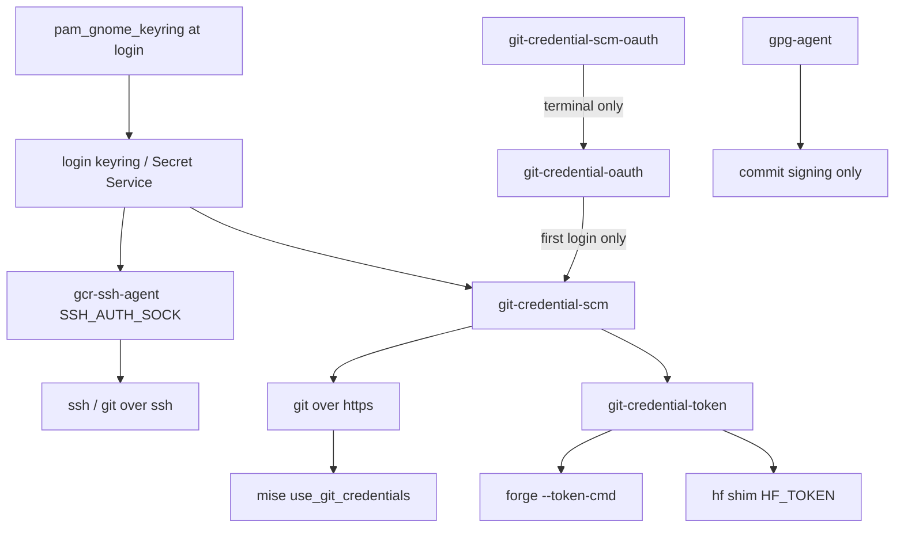

# linux-configs

Personal Linux configuration files and tooling.

## Contents

| Directory                            | Description                                                                         |
|--------------------------------------|-------------------------------------------------------------------------------------|
| [`fonts/`](fonts/)                   | Downloaded/distro fonts, fontconfig rules, installer and tests                      |
| [`neovim/`](neovim/)                 | Neovim configs (`nvim`, `nvimgit`, `nvimpager`) and their installer and tests       |
| [`vim/`](vim/)                       | Vim configs (`vim`, `vimpager`) and their installer and tests                       |
| [`scm-auth/`](scm-auth/)             | Keyring-backed SCM auth: single SSH agent, git credential chain, helpers and tests  |
| [`installer-libs/`](installer-libs/) | Shared installer library used by all families                                       |
| [`junie-cli/`](junie-cli/)           | Junie CLI home (`~/.junie`): agent guidelines, skills, commands, tooling            |
| [`claude-code/`](claude-code/)       | Claude Code home (`~/.claude`): non-sensitive settings, theme, MCP servers          |
| [`resources/`](resources/)           | Bundled packages (`flatpaks/`, `debs/`) and shared agent configs (`agent-configs/`) |

## Installation

Run the root installer to install and configure selected apps (all registered apps are selected by default):

```bash
./install.sh -cc
```

Each family can also be installed on its own by running its own installer, e.g. `fonts/install.sh`, `neovim/install.sh` or `vim/install.sh`.

Flags: `-h` help, `-cc` clean configs, `-cp` clean packages, `-sp` skip packages, `-sc` skip configs, `-im` install mode (`system`, `user`, `auto`),
`-cm` config mode (`global`, `users`, `local`, `auto`).

### Installer Layout

`installer-libs/common.sh` is a compatibility entrypoint that loads focused modules: `cli.sh` parses flags, `registry.sh` stores family/app
declarations and requirements, `scope.sh` resolves user/system access, `fsops.sh` handles scoped file operations, `run.sh` dispatches optional family
hooks, and `pkg/` contains the system-package, Flatpak, release-binary and app backends. Each family registers its apps, declares system requirements
once, and implements only the hooks it needs. The root runner batches the selected families' missing, available system requirements into one
package-manager transaction; optional hooks need no placeholder functions.

### App Documentation

The editor families include `man-db` and `bash-completion` as system requirements. System-package installs use the package's own documentation;
Flatpak installs copy available man pages and shell completions from the app, and release-binary installs fetch a registered man page when available.
Where a generator is configured, bash, zsh and fish completions are generated only when the system does not already provide them. User-scope docs are
installed under `$XDG_DATA_HOME` (default `~/.local/share`); system-scope docs go under `/usr/local/share`. Zsh users may need to add
`~/.local/share/zsh/site-functions` (or `$XDG_DATA_HOME/zsh/site-functions` when `XDG_DATA_HOME` is set) to `fpath`.

## Neovim Look & Behavior

- **Theme:** all three configs default to "Catppuccin Coffee" (a grey-neutral catppuccin-mocha). In `nvim` run `:Themery` to preview and switch live
  between Catppuccin Coffee, Kanagawa (Wave/Dragon), Gruvbox dark, JB and Darcula Dark; the choice is saved in `stdpath("data")/themery/state.json`.
- **Font:** provided by the `fonts` app (see [Fonts](#fonts)). Terminal Neovim cannot set its own font: select "JetBrainsMono Nerd Font" in your
  terminal emulator (`guifont` covers GUIs).
- **Popups:** menus, cmdline, search and the message console are opaque and distinct from the editor background (derived from the active theme); the
  console has its own border colour.
- **Mouse:** `mouse=a`; the wheel never changes mode and scrolls completion, command-line and right-click menus.
- **Menus:** Up/Down move, Left/Right descend/ascend submenus (otherwise no-op), Tab fills without accepting, Shift+Tab does nothing, Enter or left
  click accepts, Home/End first/last entry, PageUp/PageDown move one page.
- **Tabs:** Ctrl+PageUp/PageDown previous/next (wrapping), Ctrl+Home/End first/last.
- **Splits:** Ctrl+Alt+PageUp/PageDown previous/next (wrapping), Ctrl+Alt+Home/End first/last, Ctrl+Alt+arrows move to the nearest split in that
  direction (no wrapping).

## Fonts

`fonts/install.sh` (the fonts family runs before editor families in the root installer; `./install.sh nvim` does not touch fonts) installs:

- **Downloaded fonts:** JetBrainsMono, Symbols Nerd Font Mono (`NerdFontsSymbolsOnly`), FiraCode, FiraMono, Mononoki and Hack Nerd Fonts, plus Gelasio
  and Comic Relief (used by the metric-substitution rules). Each family is stored in its own directory under `~/.local/share/fonts` (`-im user`) or
  `/usr/local/share/fonts` (`-im system`). Already installed fonts are skipped; offline or missing download tools only logs a notice. The Nerd Font
  list is the `NERD_FONTS` array in `fonts/install.sh`.
- **Distro font packages:** the installer declares `fontconfig`, `curl`, `unzip`, and the available equivalents of Croscore, Caladea, Carlito, DejaVu,
  Droid fallback, Font Awesome, FreeFont, Inter, Lato, Liberation, Linux Libertine, Noto (core/extra/mono/UI/CJK/emoji), Open Sans, Gentium, STIX,
  Ubuntu, URW and Inconsolata. It also requests Comic Neue where the distribution provides it. Requirements already installed or unavailable in the
  selected package manager are handled without duplicate installs; font packages currently have apt and pacman mappings, not Nix mappings.
- **Fontconfig rules** from `fonts/fontconfig/conf.d/` into `~/.config/fontconfig/conf.d` (`-cm local`/`users`) or `/etc/fonts/conf.avail` +
  `/etc/fonts/conf.d` symlinks (`-cm global`):
    - `10-nerd-font-symbols.conf`: Symbols Nerd Font Mono as fallback for `monospace` and common mono fonts, so icons render with non-Nerd fonts.
    - `50-metric-substitutes.conf`: Arial, Calibri, Cambria, Consolas, Helvetica, Times New Roman etc. map to metric-compatible fonts.
    - `60-monospace-default.conf`: `monospace` prefers JetBrainsMono Nerd Font (delete this file to keep the distro default).

`-cp` removes only the font directories created by this installer, `-cc` removes only the rule files shipped here. Terminal emulators still need their
font set manually. Test: `fonts/tests/install.sh` (offline).

## scm-auth

`./install.sh scm-auth` (or `scm-auth/install.sh`) makes the login keyring, unlocked at login by `pam_gnome_keyring`, the only store for SSH keys
and HTTPS tokens, so `git`, `ssh`, `mise`, `forge` and `hf` work right after login with no `ssh-add`, pinentry or plaintext token files.



- **One SSH agent:** `gcr-ssh-agent` (`$SSH_AUTH_SOCK`) serves every host; `gpg-agent` is only used for GPG/commit signing. The family installs
  `~/.ssh/config.d/10-scm-auth.conf` (`Match final tagged scm`: `IdentitiesOnly`, `BatchMode`, publickey only, no `IdentityAgent`) and makes
  `Include ~/.ssh/config.d/*.conf` the first line of `~/.ssh/config`. Per-host exceptions (e.g. an ops key that must stay in `gpg-agent`) go in
  your own drop-in such as `~/.ssh/config.d/90-ops.conf`.
- **Migration (once, never run by the installer):** `scm-auth-migrate` (dry run by default) shows the `~/.ssh/config` diff and the planned unit/keyring
  actions; `scm-auth-migrate --apply` backs up `~/.ssh/config` (`config.bak.<timestamp>`), comments out every `IdentityAgent` pin and `IdentityFile`
  stubs without key material (a missing `*-sk` stub next to its plain sibling line is always commented out), enables `gcr-ssh-agent.socket`,
  disables `ssh-agent.socket`/`ssh-agent.service`/`ssh-add-gitlab.service` and masks `ssh-agent.socket` when a vendor symlink (Ubuntu's
  `/etc/systemd/user/sockets.target.wants/ssh-agent.socket`) keeps it enabled (undo with `systemctl --user unmask ssh-agent.socket`; stopping it unsets `SSH_AUTH_SOCK` in the
  systemd --user environment, so migrate sets it back to the gcr socket), deletes the
  `ssh-add-gitlab` unit and `~/.local/bin/ssh-askpass-keyring`, clears the `SSH gitlab_ed25519` keyring item (`secret-tool`; skipped with a
  notice when it is not installed) and runs `git-credential-scm --apply retag` (the dry run shows the `retag` preview). A missing or failing
  `git-credential-scm` is a warning in the dry run and makes `--apply` exit 1 after the other steps ran. `--no-systemd` and
  `--no-keyring` skip those parts. Hosts whose key exists only in the agent (no private file, no `.pub`) keep their `IdentityFile` lines and get a
  warning; with `IdentitiesOnly` ssh needs the public key on disk to select the agent key, so export it first:
  `ssh-add -L | grep -F <name> > ~/.ssh/<name>.pub` (e.g. `bitbucket_ed25519`, `codeberg_ed25519`, `huggingface_ed25519`).
- **Check:** `scm-auth-status` (read-only) prints titled sections of aligned rows (`✓` ok, `✗` problem, `!` warning, `•` info, `–` skipped;
  ASCII `+ x ! * -` outside a UTF-8 locale; colour only on a terminal, `NO_COLOR` turns it off): **SSH agents** (agent in use, key counts in
  `gcr-ssh-agent` vs `gpg-agent`, user units: an `ssh-agent.socket` still `enabled` is a problem, legacy leftovers), **Hosts** (table
  `HOST AGENT SSH API`: `IdentityAgent` pin, `ssh -T` account, and a REST API identity call with the keyring token that shows only the account and
  token type; probed in parallel), **Git HTTPS credentials** (include, chain `scm → scm-oauth`, the OAuth guard mode, OAuth requests the guard
  skipped in the last 24h from `journalctl --user -t scm-auth`, the mise settings below, the `git-credential-scm` version and path, and the number
  of keyring items tagged `application=scm-auth` vs untagged `org.git.Password` items: counted from `list`, never shown; untagged items are a
  problem until `scm-auth-migrate --apply`), **Clients**, then **Next steps** (one command per problem, warnings and optional tokens last) and
  `Summary: N problem(s)`. `ssh -T` logs in as the `User` the ssh config sets for the host, else `git`. `--no-network` skips `ssh -T` and the
  API calls, `--credentials` adds per host whether a git HTTPS token is stored (never the value).
- **HTTPS credential chain:** `~/.config/git/scm-auth.gitconfig` is pulled in with `include.path` in `~/.gitconfig` and sets `credential.helper`
  `scm` then `scm-oauth` (see the OAuth guard below; `git-credential-scm` stores its result) and `username = hf` for `https://huggingface.co`.
  Forges get no fixed username: git then gets the newest keyring item for the host whatever its user (a PAT under your login or an OAuth token
  under `oauth2`); a fixed username that differs from the stored item's user (the old `username = oauth2` for gitlab.com against a PAT stored
  for `tmoore`) makes every lookup miss the keyring and fall through to the OAuth browser flow. Top-level `credential.helper` entries equal to
  `scm`/`scm-oauth` are removed from `~/.gitconfig` after the include is in place (otherwise every helper would run twice); other helpers are
  kept and reported. Each removed value is recorded in `~/.gitconfig` as `scm-auth.removedhelper`. Leftover top-level `libsecret` (the stock
  keyring helper) and bare `oauth` (it would bypass the guard) are removed and recorded the same way. `-cc` removes the include, re-adds exactly
  the recorded helpers (appended in their chain order `libsecret` → `scm` → `oauth` → `scm-oauth`; their position relative to helpers you kept
  is not preserved) and deletes the marker. A home that never had these helpers gets none.
- **OAuth guard (`git-credential-scm-oauth`):** git only reaches it when the keyring has no usable token. It runs `git-credential-oauth` (which
  opens a browser tab and waits for the login) only for an interactive git: a controlling terminal and `GIT_TERMINAL_PROMPT` not `0`. For
  background callers (IDE fetches, mise, cron, systemd units) it answers nothing, so git fails as without credentials instead of leaving a stray
  tab, and logs `no keyring token for <url>; not starting the OAuth browser flow for non-interactive caller <comm>[<pid>]` to stderr and the
  journal (`journalctl --user -t scm-auth`), so you can see which caller missed the keyring and add its token (`scm-auth-login --store-token
  <host>`). `SCM_AUTH_OAUTH=always` restores the old behaviour, `device` uses the device-code flow (still terminal only), `never` disables it;
  `store`/`erase` and options before the action (e.g. `-bearer`) are passed through.
- **Session bus:** `git-credential-scm` uses `DBUS_SESSION_BUS_ADDRESS`, else `unix:path=$XDG_RUNTIME_DIR/bus` (as sd-bus/gio do), so callers
  started without the variable (cron, some daemons) still reach the keyring.
- **Inspecting the chain:** after install the include owns the helpers, so `git config --global --get-all credential.helper` prints nothing;
  use `git config --global --includes --get-all credential.helper` (expected: `scm`, `scm-oauth`).
- **`git-credential-scm`:** our replacement for `git-credential-libsecret`, written in Zig (`scm-auth/git-credential-scm/`). It talks to the
  Secret Service over the session D-Bus (`unix:path=` addresses only) with an encrypted `dh-ietf1024-sha256-aes128-cbc-pkcs7` session, with no
  libsecret/glib. Items keep the stock attributes (`xdg:schema=org.git.Password`, `protocol`, `server`, `user`, `port` if set, `object` if a path
  is set) plus `application=scm-auth` and `tool=git|forge|hf`, with the label `scm-auth: https://host/`. Lookups match the stock attributes only and
  the secret text is the stock format, so items written by either helper are read by the other. `store` replaces the item and deletes legacy
  duplicates; `erase` with a password deletes only items holding that password. The tool comes from `helper = scm --tool=<name>`;
  `git-credential-token` passes `SCM_AUTH_TOOL` (`hf` from the shim, `forge` from the token-cmd). Admin commands (never print secrets):
  `git-credential-scm list [--all]` (time, label, attributes of the tagged items; `--all`: every `org.git.Password` item) and
  `git-credential-scm [--apply] [--tool=<name>] retag` (tag and relabel every `org.git.Password` item, `tool=forge` for `forge: …` labels,
  collapse items with identical stock attributes to the newest; preview without `--apply`). Options may come before or after the action
  (`list --all` == `--all list`); only one action is allowed. Any
  Secret Service client sees the same set: `secret-tool search --all application scm-auth` (prints the secrets too; use it on your own terminal only).
  `SCM_AUTH_ALLOW_PLAIN_SESSION=1` allows an unencrypted `plain` session and is meant for tests only.
- **Build prerequisite:** the installer builds the helper from source with zig 0.17.x (`mise use -g zig@0.17`; any other series, or no `zig` on
  `PATH`, stops the install with an error and leaves no binary): `zig build -Doptimize=ReleaseSafe` with the build cache in
  `${XDG_CACHE_HOME:-~/.cache}/scm-auth/zig`, installed as `<scoped bin dir>/git-credential-scm` (0755). A per-destination stamp in
  `${XDG_CACHE_HOME:-~/.cache}/scm-auth/stamps/` (sources + zig version + installed binary hash) skips the rebuild when nothing changed; a cold
  build takes a few minutes. `-cc` removes the binary, the stamps and the build cache. Users/system mode under `sudo` needs zig 0.17 on root's
  `PATH`.
- **Rolling back to the stock helper:** `git-credential-libsecret` must be on `PATH` or in `git --exec-path` (it is built from git's
  `contrib/credential/libsecret`). Switch the include with
  `git config --file ~/.config/git/scm-auth.gitconfig --replace-all credential.helper libsecret '^scm( |$)'` (the chain becomes `libsecret`,
  `scm-oauth`; existing items stay readable). `./install.sh scm-auth` copies `scm-auth/git/scm-auth.gitconfig` again, so make the same change
  (`helper = libsecret`) there to keep it, and `scm-auth-status` then reports the chain as a problem. `git-credential-token` and `scm-auth-login`
  pass `scm` explicitly and keep using `git-credential-scm`.
- **Shared token:** `git-credential-token <host> [username]` prints only the stored token (exit 1 and no output when there is none). It asks the
  keyring alone (`git -c credential.helper= -c "credential.helper=<bin>/git-credential-scm --tool=${SCM_AUTH_TOOL:-git}" credential fill`, the
  bare `scm` when no shell-safe absolute path is found; `SCM_AUTH_TOOL` must match `[a-z0-9_-]{1,32}`) with prompts disabled, so it never starts the OAuth
  browser flow. `SCM_AUTH_CREDENTIAL_HELPER` overrides the helper for tests only. The script never traces: `DEBUG` is ignored and inherited
  xtrace (`SHELLOPTS`, `bash -x`) is switched off first, so the token cannot reach stderr.
- **mise:** `~/.config/mise/config.toml` keeps `use_git_credentials = true` under `[settings.github]`, `[settings.gitlab]` and
  `[settings.forgejo]`; mise then asks git for the same keyring entry. The family does not change the mise config.
- **forge:** `scm-auth-login github.com` (repeat per forge domain, e.g. `gitlab.com`, `codeberg.org`) checks that the keyring holds a git HTTPS
  token for the domain, then runs `forge auth login --domain <host> --token-cmd "SCM_AUTH_TOOL=forge '<bin>/git-credential-token' <host>"`
  (absolute path: forge runs the command with `sh -c` and its own `PATH`) and removes any plaintext `token =` from that domain's section of
  `${XDG_CONFIG_HOME:-~/.config}/forge/config`, keeping the rest and the file mode; the backup `config.bak.<timestamp>` (0600) has every token
  redacted. With no stored token it explains how to get one: any `git` HTTPS operation against the host (OAuth flow) or
  `scm-auth-login --store-token <host>`, which reads a personal access token from stdin (hidden prompt on a terminal, never argv) and stores it with
  `git credential approve` through `scm --tool=forge` (user `oauth2`, `--user` overrides). Without `forge` installed it stops after the keyring
  check (exit 0). Forge configs written before the switch keep the old token-cmd without `SCM_AUTH_TOOL=forge`; it still works, but lookups are
  attributed to `git` until `scm-auth-login <domain>` is run again.
- **hf:** `scm-auth-login hf` reads the Hugging Face token from stdin (hidden prompt), stores it for `https://huggingface.co` (user `hf`,
  `scm --tool=hf`) and
  deletes the plaintext `~/.cache/huggingface/token` (`HF_HOME`/`HF_TOKEN_PATH` honoured) and only reports `stored_tokens`, which may hold other named hf accounts not in the keyring: review it and delete it by hand. The `hf` shim in the scoped bin dir runs the first
  other `hf` on `PATH` (copies/symlinks of the shim are skipped) with `HF_TOKEN` from `SCM_AUTH_TOOL=hf git-credential-token huggingface.co hf`, set for that
  process only and only when `HF_TOKEN` is unset and a token is stored; otherwise the real `hf` runs unchanged. The shim must come before the real
  `hf` on `PATH`: `~/.local/bin` before mise shims or pipx/venv dirs. The installer never overwrites a foreign `hf` at the destination (it logs a
  notice); set `SCM_AUTH_HF_SHIM_DIR` to a directory earlier on `PATH` and re-run. `-cc` deletes only `~/.cache/huggingface/token` and reports `stored_tokens` (it never removes it).
- **Gists, gcli retired:** `forge-gist list [--limit N] [--json]`, `forge-gist view <id> [--json]` call `forge api` (the forge token-cmd);
  `forge-gist create [-d DESC] [--public] [-n NAME] <file>... | -` creates a secret gist unless `--public`. `forge api` only sends flat
  `-f KEY=VALUE` fields, so create builds the body with `jq` and POSTs it with `curl`, passing the token (`GITHUB_TOKEN`, `GH_TOKEN`, else the
  keyring) as a curl config on stdin. `FORGE_GIST_API_URL` must be `https://` (loopback `http://` is accepted for tests); anything else is refused before a token is read. `gcli` is replaced by `forge api` and `forge-gist`; `./install.sh -cp scm-auth` removes `gcli` from exactly the scoped bin dir, `~/.local/bin` and `/usr/local/bin/gcli` (sudo) plus `~/.config/gcli`. Any other copy on `PATH` (system package, homebrew, mise shims, nix, cargo) is only reported: remove it with its owner (`apt`/`pacman` for system packages, the tool's own uninstall otherwise).
- **No tracing in token scripts:** `scm-auth-login`, the `hf` shim and `forge-gist` also ignore `DEBUG` and switch off inherited xtrace.
- **Status:** `scm-auth-status` also reports plaintext `token =` lines in the forge config (count only), `forge auth status` (token sources,
  never values), whether the `hf` shim comes first on `PATH`, leftover hf token files and whether `gcli` is still installed.
- **Rotation:** forget a token everywhere with `printf 'protocol=https\nhost=github.com\n\n' | git credential reject`; the next `git` HTTPS
  operation in a terminal runs the OAuth flow again and stores the new token, which `forge`, `hf` and `mise` then pick up.
- **Tangled (`tangled.org`):** its knots accept any key over SSH but identify it (and allow pushes) only by the atproto handle the key is
  published under, used as the login name; as `git@` the knot answers `Hi there!` or `Permission denied`. Set `User <handle>` (e.g.
  `catdaddy.tngl.sh`) in the `Host tangled.org` stanza of `~/.ssh/config` and rewrite `git@` remotes with
  `git config --global url."<handle>@tangled.org:".insteadOf git@tangled.org:`; `ssh -T tangled.org` then answers `Hi @<handle>!`.
  `scm-auth-status` flags the unidentified case.

### Ops keys that live only in gpg-agent

`scm-auth-migrate --apply` comments out the `Host *` `IdentityAgent` pin, so non-SCM hosts fall back to `$SSH_AUTH_SOCK` (gcr-ssh-agent).
Keys that exist only in gpg-agent (`~/.gnupg/sshcontrol`, no file on disk, e.g. ops/admin keys) would then disappear for those hosts. Keep them
reachable with a local drop-in that the family does not manage (`-cc` never touches it), e.g. `~/.ssh/config.d/90-ops.conf` (0644):

```sshconfig
Match final !tagged scm
    IdentityAgent ${XDG_RUNTIME_DIR}/gnupg/S.gpg-agent.ssh
```

It sorts after `10-scm-auth.conf` and the `Include` is the first line of `~/.ssh/config`, so it applies to every untagged host that doesn't
set its own `IdentityAgent`, while tagged SCM hosts keep `$SSH_AUTH_SOCK`. Use the socket from `gpgconf --list-dirs agent-ssh-socket` if it differs. Check with
`ssh -G github.com | grep -i identityagent` (empty) and `ssh -G some-ops-host | grep -i identityagent` (the gpg socket). Delete the file to go
fully single-agent once those keys live in gcr-ssh-agent.

### Organizations that restrict OAuth apps

A `403` or `Repository not found` over HTTPS for one organization's repos (e.g. `NumberSentry`) while others work means the organization restricts
third-party OAuth apps; it cannot be fixed locally.

- **Organization owner:** GitHub, Organization, Settings, Third-party Access, OAuth app policy: approve `git-credential-oauth`
  (client ID `b895675a4e2cf54d5c6c`).
- **Member:** request access at <https://github.com/settings/connections/applications/b895675a4e2cf54d5c6c> (`Request` next to the organization).
- **Alternative:** a fine-grained personal access token scoped to the organization: run `git credential approve`, type `protocol=https`,
  `host=github.com`, `username=<user>`, `password=<token>` on separate lines and finish with an empty line (keeps the token out of shell history).

## Post-Install Shell Configuration

Add the following to `~/.bashrc` to wire up the installed apps:

```bash
export PAGER='nvimpager'
export MANPAGER='nvimpager -p'
export EDITOR='nvim'
export VISUAL='nvim'
```

## Post-Install Git Configuration

Add the following to `~/.gitconfig` to use `nvimgit` as your Git editor and diff/merge tool:

```ini
[core]
pager = nvimpager -a
editor = NVIM_APPNAME=nvimgit nvim
[diff]
tool = nvim
[difftool "nvim"]
cmd = NVIM_APPNAME=nvimgit nvim -d "$LOCAL" "$REMOTE"
[merge]
tool = nvim
[mergetool "nvim"]
cmd = NVIM_APPNAME=nvimgit nvim -d "$LOCAL" "$MERGED" "$REMOTE"
```

## Tests

Installer and headless, no-UI config-load tests:

```bash
fonts/tests/install.sh
installer-libs/tests/run.sh
scm-auth/tests/install.sh # temp HOME + stub zig; SSH drop-in, Include line, helpers, helper build/stamp/-cc, idempotency, no systemctl/secret-tool
scm-auth/tests/migrate.sh # temp HOME + stubs; scm-auth-migrate dry-run/apply/idempotency/retag, scm-auth-status incl. helper counts
scm-auth/tests/credential-scm.sh # private dbus-run-session + gnome-keyring-daemon, compat with git-credential-libsecret; builds with zig unless SCM_BIN=<binary>; skips without its tools
(cd scm-auth/git-credential-scm && zig build test) # Zig unit tests (zig 0.17)
scm-auth/tests/git.sh # temp HOME; git include, helper dedupe/restore, git-credential-token (stub + real git 'store'), status git/mise
scm-auth/tests/forge-hf.sh # temp HOME + stub forge/curl/hf; scm-auth-login, hf shim, forge-gist, shim guard, gcli cleanup, status clients
neovim/tests/startup.sh # nvim, nvimgit, nvimpager and the nvimpager runtime-load case
vim/tests/startup.sh # vim
```

## Agent Configs

| Directory                  | Synced to                  | Contents                                                                                                                                      |
|----------------------------|----------------------------|-----------------------------------------------------------------------------------------------------------------------------------------------|
| `resources/agent-configs/` | `~/.junie` and `~/.claude` | `skills/`, `commands/` (agent-agnostic templates) and `custom/` (docs, scripts, shims) used by both agents                                    |
| `junie-cli/config/`        | `~/.junie`                 | `AGENTS.md`, `config.json`, `extensions/`, `mcp/`, `models/`, `sandbox.json`; `skills`/`commands`/`custom` link to `resources/agent-configs/` |
| `claude-code/config/`      | `~/.claude`                | `settings.json`, `themes/`, `mcp/mcp.json`, `CLAUDE.{security,workdir}.md`; `skills`/`commands`/`custom` link to `resources/agent-configs/`   |

Each agent dir has a `sync.sh` that installs **fresh copies** into the agent's home: top-level files are overwritten and each managed directory is
mirrored, so files removed from the repo are deleted there too. Symlinks into `resources/agent-configs/` are resolved, `__pycache__/` is ignored, and runtime state
outside the managed entries (sessions, logs, caches, credentials, history) is never touched. `-n` prints what would change or be deleted without
writing anything.

- `junie-cli/sync.sh` mirrors every entry of `junie-cli/config/` into `~/.junie` (`JUNIE_HOME` overrides). Local-only paths inside managed
  directories are kept: `extensions/marketplaces/` (installed by Junie) and `models/inactive/` (model configs holding API keys); extend the `KEEP`
  list in the script for more.
- `claude-code/sync.sh` mirrors `skills/`, `commands/`, `custom/` and `themes/` into `~/.claude` (`CLAUDE_HOME` overrides). `settings.json` becomes
  the repo version plus only the local keys listed in `PRESERVE_SETTINGS` (`autoMode`, which names work repositories), so keys removed from the
  repo disappear locally. Each MCP server in `mcp/mcp.json` is added to `~/.claude.json` with `claude mcp add-json`, or replaced when it differs;
  servers that are not in the repo are left alone and listed (only for the real `~/.claude`). `~/.claude/CLAUDE.md` is generated from
  `junie-cli/config/AGENTS.md` sections 0-5 (pointing at `~/.claude/custom/`) plus `CLAUDE.security.md` and `CLAUDE.workdir.md`.

Slash commands in `resources/agent-configs/commands/` are templates: each sync renders `{{agent_home}}`, `{{agent}}` and `{{args}}` to
`~/.junie`/`junie`/`$prompt` or `~/.claude`/`claude`/`$ARGUMENTS`. `histmgr` (session history) and `agentmgr` (agent config) work on either agent:
`--agent junie|claude`, else `AGENT_TARGET`, else the calling agent, else the only installed agent, else an interactive prompt when the shims in
`~/.<agent>/custom/bin/` are run from a terminal. See `resources/agent-configs/custom/docs/commands-catalog.md`.

Only non-sensitive files are tracked. Left out on purpose: `~/.claude/.credentials.json`, `~/.claude.json` (account and project state; its MCP
servers are mirrored in `claude-code/config/mcp/mcp.json`), session data (`projects/`, `history.jsonl`, `file-history/`, `sessions/`, caches,
`plans/`), server-managed `policy-limits*`/`remote-settings*` files, plugin caches, Junie's `models/inactive/`, and the `autoMode` block of
`settings.json`, which describes work repositories.

## License

[GPL-3.0](LICENSE.md)
