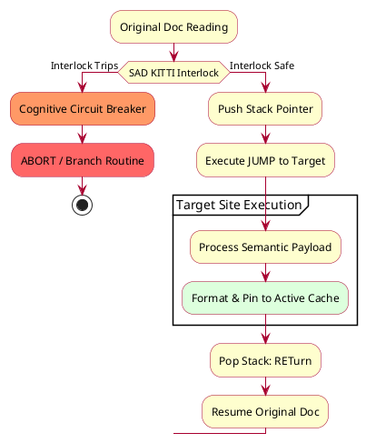

<!-- sadkitti-lint: ignore -->

# Specification: SAD KITTI

### Semantic Agent Directives — Konditional Interlock for Task Transitions and Inference

---

## 1. Executive Summary & Design Philosophy

Traditional software architectures force Large Language Model (LLM) agents to act like rigid, deterministic compilers.
Forcing an agent to parse abstract, non-native code structures (like nested JSON or heavy YAML automation strings)
inside documentation causes severe context-switching latency, state fragmentation, and token inefficiencies.

**SAD KITTI** establishes a hybrid engineering paradigm. It isolates routing configurations within predictable
development blocks, but uses high-density **Semantic Primitives**. This allows the agent to execute complex data
retrieval, conditional branches, and context pooling using its native linguistic reasoning capabilities.

### Core Architectural Pillars

* **Zero Syntax Collision**: Encapsulated entirely within custom Markdown code blocks (` ```sadkitti `). This guarantees
  zero parsing conflicts with standard Markdown links, images, or formatting tokens.
* **Semantic Native Execution**: Eliminates intermediate JSON/YAML parsing layers. The agent interprets the instructions
  using its native attention mechanism.
* **Developer-Readable Linting**: Highly scannable for developers auditing documentation dependencies, while remaining
  fully scriptable via regex patterns.

---

## 2. Definitional Core: The "Interlock" Mechanic

A foundational element of this architecture is the **Interlock**. In physical systems, an interlock prevents operation
unless safe, specific parameters are strictly met.

Within SAD KITTI, the Interlock acts as an automated cognitive circuit breaker. It connects the physical file layout
state directly to the agent's reasoning layer. If a prerequisite documentation dependency fails, is unauthorized, or is
missing, the Interlock trips—forcing an immediate execution branch or a clean `ABORT` routine, saving computing costs
and preventing hallucination loops.

---

## 3. Syntax Notation & Topology

Every directive block follows a strict, zero-overhead structural container combined with a free-form semantic payload.
The notation utilizes **CAPITALIZED_COMMANDS** for action operators and standard natural text for paths and conditions,
removing coding symbols completely.

```sadkitti
[CONDITIONAL <semantic_arguments>]
  <CONDITIONAL_TASK> [semantic_arguments]
  [...]
[...]
[<UNCONDITIONAL_TASK> [semantic_arguments]]
[...]
```

### Visual Anchors & Language Target

The code block language specifier (`sadkitti`) acts as the immediate structural hook for the platform's regex loaders
and the agent's attention layers.

---

## 4. The Core Semantic Primitives

To prevent instructions from becoming overly verbose while maintaining strict guardrails, SAD KITTI defines five
immutable control commands.

### I. REFERENCE

Instructs the agent to perform a targeted context JUMP. It must locate the file, isolate the specific header or anchor,
and absorb its contents.

```sadkitti
REFERENCE "DOC_NAME.md" AT SECTION "#Authentication"
EXTRACT only the core token handshake logic
```

### II. REQUIRE

Establishes a mandatory data dependency. If this directive cannot be fulfilled, it trips the runtime Interlock.

```sadkitti
REQUIRE "DEPENDENCIES.md"
IF file is missing or unreadable -> ABORT immediately and log error: "Build chain broken."
```

### III. CACHE

Directs the memory retention behavior of the retrieved data. This handles the **Konditional-Inferencing** aspect,
telling the agent whether to inject the text into the active context window or store it in localized memory states.

```sadkitti
REFERENCE "API_ENDPOINTS.md"
CACHE this text layout in local system state for all following blocks
```

### IV. IF / ELSE

Handles the **Konditional-Inclusion** parameters, loading or unloading critical external documentation pathways
dynamically.

```sadkitti
IF active state indicates environment is "production"
  REFERENCE "SECURE_CONFIG.md"
ELSE
  REFERENCE "STAGING_CONFIG.md"
```

### V. ABORT

The quick-exit circuit breaker triggered by an Interlock failure. It overrides the LLM's natural tendency to wander
down circular reasoning loops.

```sadkitti
IF target reference "#LegacyV1" does not exist
  ABORT pipeline with message: "Target subsection deprecated."
```

---

## 5. Execution Stack Mechanics (JUMP & RET)

When an agent hits a SAD KITTI block, it processes the task using an implicit dual-pointer execution flow:



1. **The JUMP**: The agent intercepts the `sadkitti` block. It freezes progress on the current markdown layout, pushes
   the current document state and location to its working memory stack, and opens the target reference path.
2. **The Payload Execution**: The semantic rules inside the block (filtering text, checking conditions) are executed
   against the target file.
3. **The RETurn**: The extracted knowledge is formatted, pinned to the active cache structure, and the agent pops its
   memory stack to return directly to the line immediately following the closing triple-ticks (` ``` `).

---

## 6. Token-Efficiency Rationale: Semantic Native vs. Abstract Format

### Why not YAML / JSON directives?

Abstract machine formats require the agent to perform a dedicated parsing step — effectively acting as a compiler
before it can reason. This introduces two compounding inefficiencies:

1. **Context-switch cost**: The agent must shift from natural-language reasoning mode to deterministic code-execution
   mode. LLMs are not optimized for this; the attention mechanism must re-orient, consuming additional tokens.
2. **Error surface expansion**: Any deviation from strict syntax (a trailing comma, mismatched quote) causes the agent
   to spend further tokens diagnosing a parse failure rather than executing the task.

### Why semantic natural language inside fenced blocks?

LLMs process semantic text at near-zero marginal cost — it aligns with how the attention mechanism already works.
`CAPITALIZED_COMMANDS` act as high-salience tokens that immediately activate the relevant action pathway without
requiring a grammar tree. The fenced block (` ```sadkitti `) provides structural isolation for tooling (linters,
regex extractors) without adding cognitive overhead for the agent.

### Observed efficiency characteristics

| Approach                     | Agent context switches | Typical tokens to resolve directive | Hallucination risk on parse failure |
|------------------------------|------------------------|-------------------------------------|-------------------------------------|
| Abstract YAML/JSON           | 1 per directive        | High (grammar + execution)          | Medium–High                         |
| Semantic native (`sadkitti`) | 0                      | Low (direct attention activation)   | Low (ABORT circuit-breaker)         |

### Design conclusion

Semantic native directives leverage the model's existing strengths. The `sadkitti` block format achieves the best of
both worlds: **developer-scannable structure** (regex-extractable, lintable, version-controllable) combined with
**native LLM execution** (no intermediate parse layer, direct semantic comprehension, minimal token overhead).
